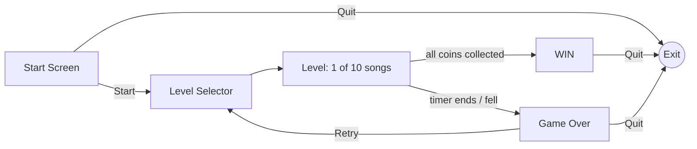

# Cong Rush

**A 2D mobile platformer where every level is themed around a song.**

---

## About

Cong Rush is a game I built during my Bachelor's degree (around 2017). You play a little robot running and jumping across platforms, racing a countdown timer to collect every coin before time runs out. There are 10 levels, and each one is themed after a pop song from that era.

> **Archive note:** the original Unity project folder was lost. This repo was put together from the compiled Android build (`com.unity3d.CongRush1`). It documents the game's design, scenes and scripts. There's no editable Unity project here, and the APK isn't included because the levels use copyrighted music.

## Gameplay

- **Goal:** collect every coin in the level before the timer hits zero.
- **HUD:** Score, Coins Remaining and a countdown Timer.
- **Movement:** on-screen virtual joystick plus a Jump button, with double jump.
- **Hazards:** platforms that fall shortly after you land on them, and a death zone below the level.
- **Win:** grab every coin and you get the *Game Win* screen.
- **Lose:** fall off, or let the timer run out, and you get the *Game Over* screen with Retry / Quit.

## Levels

| # | Level | # | Level |
|---|---|---|---|
| 1 | 24K Magic | 6 | Cold Water |
| 2 | Black Beatles | 7 | Hymn |
| 3 | Rockabye | 8 | In the Name of Love |
| 4 | Cheap Thrills | 9 | Let Me Love You |
| 5 | Closer | 10 | Starboy |

## Scene flow

## Tech

| | |
|---|---|
| Engine | Unity 5.5.2f1, 2D physics (`Rigidbody2D`, `Collider2D`) |
| Language | C# (Mono scripting backend) |
| Input | Unity Standard Assets `CrossPlatformInput` (mobile joystick + jump button) |
| Character | `CharacterRobotBoy` from Unity Standard Assets (2D) |
| UI | Unity UI (uGUI) canvases and buttons |
| Platform | Android (armeabi-v7a, x86), also flagged for Android TV launcher |
| Permissions | None |

## Code structure

The game logic is about 25 small `MonoBehaviour` scripts. The main ones:

| Script | Role |
|---|---|
| `SimplePlatFormController`, `PlayerController` | Player movement, jump / double jump, ground check, sprite flip |
| `CameraController` | Follows the player |
| `SpawnManager`, `SpawnCoin`, `SpawnCoins`, `Coin` | Spawns coins and platforms, handles coin pickups |
| `ponits`, `remaining` | Score and "coins remaining" HUD text |
| `CountDownTimer` | Level timer that triggers Game Over |
| `PlatformFall` | Platforms that drop after a short delay |
| `Instantiation`, `DestroyCloud` | Background cloud spawning and cleanup |
| `GameOver`, `Win`, `WinMenu`, `Nextlevel`, `Reset` | Menu and scene navigation |

See **[docs/SCRIPTS.md](docs/SCRIPTS.md)** for the full list of classes, recovered from the build's metadata.

## License / credits

- Code © Chinmay Patil. Shared for portfolio and archival purposes.
- Robot character and mobile input come from Unity Standard Assets.
- Vector/GUI helpers from the open-source `wHiteRabbiT.Unity` utilities.
- Song names are used as level titles only. The music belongs to its respective artists and labels and isn't included here.
